# GFNet for Identifying Alzheimer's Disease in Brain MRIs
## Table of Contents
- [GFNet for Identifying Alzheimer's Disease in Brain MRIs](#gfnet-for-identifying-alzheimers-disease-in-brain-mris)
  - [Table of Contents](#table-of-contents)
  - [The Algorithm](#the-algorithm)
  - [Reasoning Behind the Model](#reasoning-behind-the-model)
  - [Usage and How to Run the Code](#usage-and-how-to-run-the-code)
  - [Feasibility Review](#feasibility-review)
    - [User Need, Scope \& Acceptance Criteria](#user-need-scope--acceptance-criteria)
    - [Model Choice \& Course Concepts](#model-choice--course-concepts)
    - [Preliminary Feasibility Evidence](#preliminary-feasibility-evidence)
    - [Risks, Budget \& Fallback](#risks-budget--fallback)
  - [Dependencies and Reproducibility](#dependencies-and-reproducibility)
    - [Dependencies](#dependencies)
    - [Reproducibility](#reproducibility)
  - [Example Inputs and Outputs and Plots](#example-inputs-and-outputs-and-plots)
    - [True Positive Case:](#true-positive-case)
    - [True Negative Case:](#true-negative-case)
    - [False Positive Case:](#false-positive-case)
    - [False Negative Case:](#false-negative-case)
    - [Confusion Matrix](#confusion-matrix)
    - [Accuracy Curve](#accuracy-curve)
    - [ROC Curve](#roc-curve)
    - [Loss Curve](#loss-curve)
  - [Preprocessing and Data Split](#preprocessing-and-data-split)
    - [Dataset](#dataset)
    - [Pre-Processing](#pre-processing)
    - [Data Split](#data-split)
  - [Investigation](#investigation)
    - [Benchmarking Against CNN](#benchmarking-against-cnn)
    - [Computational Efficiency](#computational-efficiency)
    - [GFNet Error Autopsies](#gfnet-error-autopsies)
      - [High Confidence False Positive](#high-confidence-false-positive)
      - [Medium Confidence False Positive](#medium-confidence-false-positive)
      - [High Confidence False Negative](#high-confidence-false-negative)
      - [Medium Confidence False Negative](#medium-confidence-false-negative)
    - [Overall Autopsy Takeaway and Recommendations](#overall-autopsy-takeaway-and-recommendations)
    - [Recommendations and Trade-Offs](#recommendations-and-trade-offs)
    - [Answering The Open Research Question](#answering-the-open-research-question)
  - [Reference List](#reference-list)
  - [Artificial Intelligence Usage Disclosure](#artificial-intelligence-usage-disclosure)

## The Algorithm
Alzheimer’s disease (AD) is a neurodegenerative condition characterised by difficulties with memory, fatigue, confusion and physical decline. When clinicians suspect AD, it is important that any brain MRIs produced are correctly interpreted. False positives lead to unnecessary testing and use of hospital resources, while false negatives lead to delayed treatment and care, and potentially a misdiagnosis.

The goal of this algorithm is to assist clinicians by being able to analyse brain scans and identify if someone has AD or is cognitively normal (NC). It will achieve this by being able to analyse a brain MRI and determine whether the scan indicates AD or NC, and a probability of it being AD (P(AD)). 

The algorithm is based on Y. Rao, W. Zhao, Z. Zhu, J. Lu, and J. Zhou, “Global filter networks for image classification,” IEEE Trans. Pattern Anal. Mach. Intell., vol. 45, no. 6, pp. 7837–7850, 2023. It copies its structure by using a learned positional embedding, a global filter layer, same block structure and final layer. It then slightly modifies it by adding a 4 layer convolutional stem at the beginning.

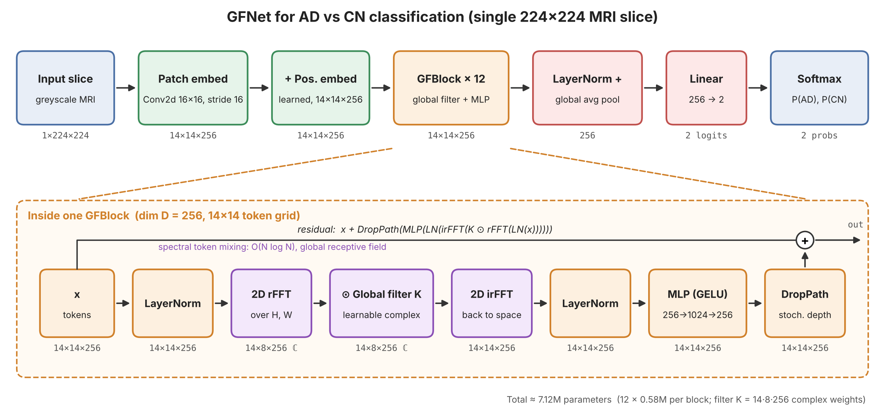

The model works in four primary stages. First, it takes an input image, crops it to 200x200, resizes it to 224x224 and passes it through a convolutional stem. This consists of four 3x3 convolutions that produce an output of 256 channels which each are 14x14. The next step is global filtering. Each of the 12 GFNet blocks applies a LayerNorm, applies a fast fourier transform, multiplies by a learned complex weight and applies an inverse fast fourier transform. The next step is channel mixing. Inside the same block, another LayerNorm and two layer MLP mix information across channels for each token. The whole block is wrapped in a residual connection as well. Finally, classification happens. This is done after all 12 blocks and their output is normalised into one 256-dimensional vector. A linear layer maps it to either AD or NC and softmax is used to give P(AD) and P(NC).

## Reasoning Behind the Model
For the following section, trials refer to the trials in GFNet_model_tuning

**Cropping:**
Cropping to 200x200, before rescaling it to 224x224 was done because it was found to improve validation accuracy. The dimension of 200x200 was chosen since it safely did that without cropping the brain for any slice. Between trial 7 and 8, one of the key changes made was added this cropping before rescaling. This, alongside increasing the Affine Transformation strength, improved validation accuracy from 0.813 to 0.863. It is likely that cropping improved model performance since it significantly reduced the proportion of the image that was empty space, giving the model more focus on the brain.

**Convolutional Stem:**
The model passes a slice through four 3x3 convolutions with stride 2 (number of channels 1 -> 32 -> 64 -> 128 -> 256), before into the GFNet's blocks. Each convolution is followed by a BatchNorm and ReLU (except for the last). This creates 256 channels of 14x14 slices. This replaces the paper's  Patch Embedding. The reason this was done is seen in trial 1 and 5. The only difference between these runs was that trial 5 used this a convolutional stem whereas trial 1 used a patch embedding. Trial 5 has a validation accuracy 0.844 compared to 0.783 from Trial 1, giving evidence this led to better results. Size of the convolutional stem was also tested in trials 6 and 7, where the difference between them was 6 had structure [in_chans, 32, 64, 128, embed_dim], while 7 had structure [in_chans, 16, 32, 64 embed_dim]. Trial 6 performed better with a validation accuracy of 0.843, compared to 0.813 from trial 7, so that was used. 

**Affine Transformation:**
Trials 1 and 2 compared the effect of random Affine Transformations. Trial 1, which used it, produced a validation accuracy of 0.783. Trial 2, which only differed in not using it, produced a validation accuracy of 0.724. This was evidence that by training the model with random affine transformations applied, there was a better generalisation. The strength of the affine transformation was also tested. Between trial 7  and 8, one of the changes was increasing the transformation from 10 degrees to 15 degrees, as well as adding cropping. These changes improved validation accuracy from 0.813 to 0.863.

**Random Horizontal Flips:**
Random horizontal flips were tested in trials 1 and 3. Trial 1, which used it, produced a validation accuracy of 0.783. Trial 3, which only differed in not using it, produced a validation accuracy of 0.791. Although this initially indicated that random horizontal flips reduced test accuracy, further testing on a later model showed the opposite. Trial 8 and 9 had the same model, except 9 did not use horizontal flips. Trial 8 had the higher validation test accuracy of 0.863, while 9 had 0.853. It is likely that this transformation had minimal impact overall, but was still kept since it improved validation accuracy on the latest model.

**Drop Rate:**
Drop rate was tested at either 0.1 or 0.3. Trial 1 and 4 showed the difference between them on the base models. Trial 1, which used a drop rate of 0.1, had a validation accuracy of 0.783, while trial 4, which had a drop rate of 0.3, had a validation accuracy of 0.793. Drop rate was also tested when there was a convolutional stem in trials 5 and 6, which had drop rates of 0.1 and 0.3, respectively. Both trials produced almost the same validation accuracy, with trial 6 at 0.843 compared to 0.844 from trial 5. Although trials 5 and 6 showed no meaningful difference, trials 1 and 4 showed that increasing drop rate to 0.3 can help, so that was chosen.

**Scan Level Predictions:**
In a clinical setting, a diagnosis is not made over a single slice. It is almost always made over the entire scan. This model does the same by also calculating scan-level statistics. To do this, for each scan, the P(AD) is averaged across every slice. The final average is then used to determine the prediction. This process has resulted in an increase in accuracy. On trial 8, the validation accuracy per slice was 0.863, but per scan was 0.916.

**Selecting the Model on Validation Accuracy During Training:**
During training, it was observed that the last model would be outperformed on models from previous epochs. This is due to overfitting onto the training set and volatility. This is seen in the simple CNN's accuracy curve. In the plot, the validation accuracy experiences large fluctuations. By taking the best model on validation accuracy, it reduces volatility and dependence on the last epoch being good. As a result, for the GFNet, the model taken is the one that produced the highest validation accuracy as well.

**Final Model:**
The final model uses a Convolutional Stem of [in_chans, 32, 64, 128, embed_dim], Affine Transformation up to 15 degrees, random horizontal flips, cropping to 200x200 pixels, before rescaling and a drop rate at 0.3.

**Overall Testing Summary (On Validation Set)**
| Trial | Change                                         | Accuracy  | AUROC     | Specificity | Recall (AD) |
|-------|------------------------------------------------|-----------|-----------|-------------|-------------|
| 1     | Baseline: patch embed + affine + flip          | 0.783     | 0.865     | 0.792       | 0.775       |
| 2     | No affine                                      | 0.724     | 0.806     | 0.581       | 0.862       |
| 3     | No flip                                        | 0.791     | 0.861     | 0.779       | 0.803       |
| 4     | Drop rate increase from 0.1 to 0.3             | 0.793     | 0.864     | 0.818       | 0.769       |
| 5     | Conv stem [32, 64, 128], drop rate 0.1         | 0.844     | 0.923     | 0.793       | **0.894**   |
| 6     | Conv stem, drop rate 0.3                       | 0.843     | 0.923     | 0.838       | 0.848       |
| 7     | Smaller conv stem [16, 32, 64]                 | 0.813     | 0.913     | **0.890**   | 0.739       |
| 8     | Conv stem + increased affine + CenterCrop(200) | **0.863** | **0.932** | 0.870       | 0.856       |
| 9     | Trial 8 without flip                           | 0.853     | 0.915     | 0.861       | 0.845       |

Based on the above metrics, trial 8 produces the best model

## Usage and How to Run the Code
There are five folders in the main directory. simple_CNN, data_processing, README_images, GFNet_model_tuning and GFNet_model_outputs. README_images is used just to store images for the README file. data_processing contains scripts for analysing and splitting the dataset, as well as creating heatmaps. simple_CNN contains the files and outputs for the baseline model. GFNet_model_outputs contains the GFNet's outputs and GFNet_model_tuning contains outputs from different experiments. In the main directory, there are the 5 fundamental files: dataset.py, evaluate.py, modules.py, predict.py, train.py and README.md. The first five create the GFNet, and the last one is the report.

To use the model, first go to train.py and run the script as per the doc string. After running to the desired number of epochs, you will have accuracy and loss plots saved as well as the model. Next, use evaluate.py to run the model on either the validation or test set and produce a confusion matrix, roc curve and a CSV of predictions. Train and evaluate have been split since it allows evaluation to occur on saved weights produced by training. Note that the weights are not in the repo.

More specific info on usage and purpose is within each file.

## Feasibility Review
### User Need, Scope & Acceptance Criteria
The intended users are clinicians who can use this tool for automated screening to improve productivity and reduce diagnostic errors or misses. The scope will be limited to Alzheimer’s Disease and a positive/negative classification with confidence, using just MRI scans.  

-	Ambiguous cases: Confidence scores (A probability of AD) should be reliably produced for all MRIs. This confidence score should correlate with diagnostic correctness.

-	Handling: For all high confidence negatives, a negative case should be reported. For medium or high confidence positives, a positive case should be reported, and further testing commence. For any medium confidence negatives, or any low confidence result, there should be a human review process.

-	False negatives: Maximising recall is the primary focus. This is because a false negative leads to undetected AD, whilst a false positive leads to an unneeded test. The model will be considered successful if it can achieve a recall greater than 80%.

-	Overall positives: Although maximising recall is the primary focus, false positives lead to unnecessary health scares and follow up tests, causing strain on the healthcare system. Thus, it is important the specificity is greater than 80%.

-	Computational limits: To process a significant number of images and automate this, it is important the inference time is minimised. The model is considered successful if it can achieve a median inference time of 10ms or less, per image, on a standard A100 GPU. 

### Model Choice & Course Concepts
The data will be split by patients. This is important to prevent data leakage and inflated accuracy scores. It will then be split into approximately 70% training , 15% testing and 15% validation. These percentages were chosen since ADNI is a large dataset (>10 000 entries) and this is a recommended split, and CV is not feasible due to training times.
GFNet will be chosen for the model, with a CNN as the baseline. GFNets  have been used before for AD classification, most notably by Xu et.al. in 2025. With MRI AD vs NC, they achieved an accuracy of 92.53% and were able to improve this to 98.91% by using a modified GFNet that also incorporated PET scans. This study serves as proof that GFNets, even with just MRI data, can detect AD at a reasonable accuracy rate. 
A typical CNN will be chosen for the baseline. This is since this task is fundamentally computer vision, where a model is looking for signs of AD such as progressive hippocampal and cortical atrophy with ventricular enlargement.

### Preliminary Feasibility Evidence
This is feasible and has been done before as stated in the previous section. The data itself is not split by patient yet, and this will have to be done to prevent data leakage. With an A100 and using the ADNI dataset, a GFNet is estimated to take less than 3hrs to train, while a CNN would be at most 30m (estimates from previous runs I have done). I have access to an A100 so there are no issues with resources.

### Risks, Budget & Fallback
I have 80 computing credits with Google Colab, and also free access to UQ’s Rangpur Cluster. This will give me access to A100s and other GPUs to train on. The primary risk of either model is data leakage due to patients not being kept together on datasets, leading to overconfidence and inflated accuracy scores. If GFNets do not work, I can try a ConvNeXt instead.

## Dependencies and Reproducibility
### Dependencies
| Package      | Version |
|--------------|---------|
| Python       | 3.13.16 |
| torch        | 2.11.0 (CUDA 13.0) |
| torchvision  | 0.26.0  |
| scikit-learn | 1.6.1   |
| matplotlib   | 3.10.0  |
| Pillow       | 11.3.0  |
| pandas       | 2.2.3   |

### Reproducibility
The hardware used to run the models was a NVIDIA A100-SXM4-40GB. The hardware is important when it comes to reproducing model training and inference times.

The test train val split is reproducible since it was done with randomstate=42. Training was also seeded, meaning that the models tested and evaluated can be reproduced.

As a whole, if the scripts were run again on any capable GPU, the results achieved are highly reproducible. The only exception is inference time since it is dependent on the GPU's strength and could only be reproduced if the model was run on a similar one.

## Example Inputs and Outputs and Plots
### True Positive Case:
The input was an AD brain MRI\
**IMAGE ID:** 258598_90\
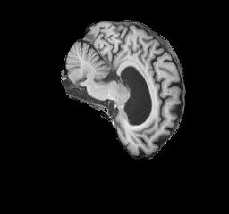\
**Prediction made:** AD\
**P(AD):** 0.967\
There were 1878 images that were true positives (40.83%)

### True Negative Case:
The input was a NC brain MRI\
**IMAGE ID:** 1009810_100\
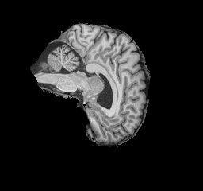\
**Prediction made:** NC\
**P(AD):** 0.001\
There were 1803 images that were true negatives (39.20%)

### False Positive Case:
The input was a NC brain MRI\
**IMAGE ID:** 1075136_84\
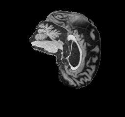\
**Prediction made:** AD\
**P(AD):** 0.95\
There were 377 images that were false positives (8.20%)

### False Negative Case:
The input was a AD brain MRI\
**IMAGE ID:** 300034_76\
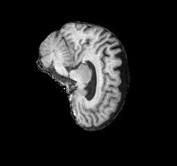\
**Prediction made:** NC\
**P(AD):** 0.288\
There were 542 images that were false negatives (11.78%)

### Confusion Matrix 
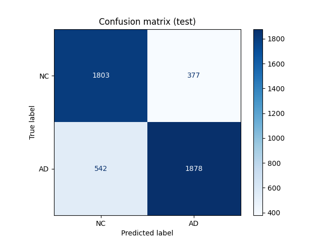\
As stated above, there were 1803 images that were true negatives (39.20%), 1878 images that were true positives (40.83%), 377 images that were false positives (8.20%) and 542 images that were false negatives (11.78%).

### Accuracy Curve
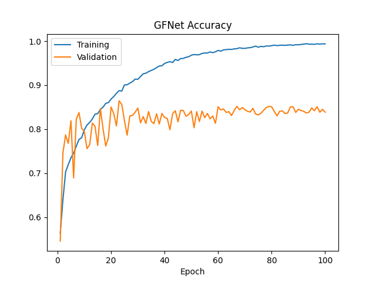\
By the end of training, the model reached a validation accuracy of 83.9% and a training accuracy of 99.4%. The saved model is from epoch 23, which had the highest validation accuracy (86.4%).

### ROC Curve
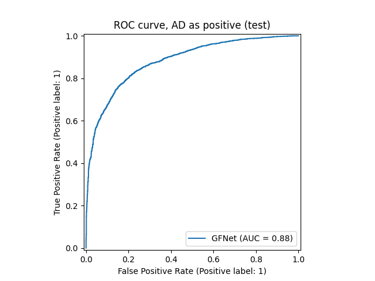\
On the test set, the saved model reached an AUROC of 0.881.

### Loss Curve
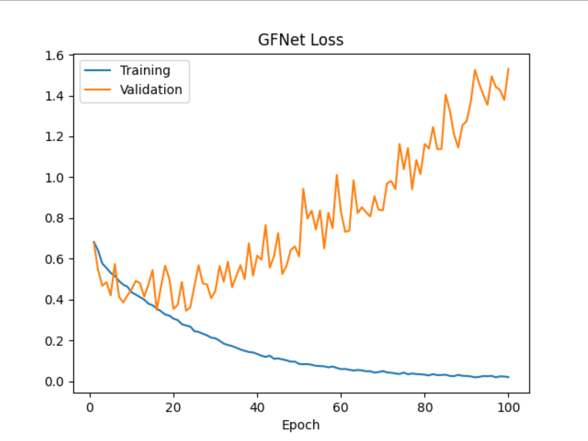\
The model seems to be overfitting since after epoch 23, validation loss keeps climbing despite training loss going down. Fortunately, since the model taken is the one that performs the best on the validation set (rather than the last one), the final model is not as overfit.

## Preprocessing and Data Split
### Dataset
The dataset was provided by the course on the /home/groups/comp3710/ADNI. Within the folder, there was a test and train folder, and within each folder two classes, AD and NC. There were 14860 slices with AD, and 15660 that were NC. In total, there were 30520 slices. There was no major class imbalance, with AD making up 48.69% of images. Files are named scanID_sliceNumber.jpeg. There were 1526 scans, with 20 slices each.

Scans are not unique to patients, with any patient potentially having numerous scans. Using the metadata, scans can be identified to patients. Data-analysis.py shows the following:

AD: images=14860 scans=743 patients=221
NC: images=15660 scans=783 patients=459
total patients: 680 total scans: 1526 total images: 30520

In total, there are 680 patients who have produced 1526 scans. Each scan has 20 slices, giving 30520 slices in total. Further investigation also showed that every patient only went to one location. There is a class imbalance when it come to AD patients vs NC patients, where only 32.5% of patients have AD. This was not seen in number of AD slices vs number of NC slices since AD patients, on average, get more scans each. 

### Pre-Processing
The AD images were pooled and so were the NC images. After that, all the images in either set were grouped by patient and then randomly split between test train and validation sets. The split was stratified to ensure similar proportions of AD and NC patients across all six groups of images.

Images were then converted to grayscale with Grayscale(1), cropped to 200x200 with CenterCrop(200), scaled to 224x224 with Resize((224, 224)) and finally converted to tensors and normalised with ToTensor() + Normalize([0.5], [0.5]). This was done to all images to ensure consistency amongst colour, size and scale. Further justification on cropping is in [Reasoning Behind the Model](#reasoning-behind-the-model).

For training, RandomHorizontalFlip() and transforms.RandomAffine(degrees=15, translate=(0.08, 0.08), scale=(0.9, 1.1)) was also applied. The reasoning behind this was explained earlier in [Reasoning Behind the Model](#reasoning-behind-the-model).

### Data Split
Splits were done by patient rather than by scan or slice as to avoid data leakage. If splits were done by scan, then a patient with AD whose scans appear in test and train likely will skew the model due to a high correlation between the two scans (as they come from the same person).

The data was split as 70% training, 15% validation and 15% testing. These ratios were not achieved exactly since the number of slices per patient can differ, and groups were stratified on patient class. The split 70 / 15 / 15 was chosen under advice from a tutor and by this [article](https://medium.com/@kiranvutukuri/19-model-evaluation-basics-train-validation-and-test-splits-ed5bb26b088d), which stated for large dataset (>10000 items), it is better to have a larger test and validation set since the training set has enough items already. 

## Investigation
### Benchmarking Against CNN
Both models were evaluated on the same test set of 4600 images. Both models were also trained on the same set of images.

| Metric                 | CNN baseline | GFNet     |
|------------------------|--------------|-----------|
| Slice accuracy         | 0.775        | **0.800** |
| Slice macro-F1         | 0.775        | **0.800** |
| Recall (AD)            | 0.769        | **0.776** |
| Specificity            | 0.783        | **0.827** |
| Slice AUROC            | 0.854        | **0.881** |
| Scan accuracy          | 0.839        | **0.865** |
| Scan macro-F1          | 0.839        | **0.865** |
| Scan AUROC             | 0.903        | **0.932** | 

The GFNet outperforms the CNN on every metric. It improves slice accuracy by 2.5 percentage points, from 77.5% to 80.00% and slice AUROC by 0.027 from 0.854 to 0.881. Recall improves from 76.9% to 77.6% and specificity improves from 78.3% to 82.7%. At a scan level, these improvements are seen again. Scan accuracy is improved by 2.60 percentage points from 83.9% to 86.5%, and scan AUROC improves by 0.029 from 0.903 to 0.932.

| Model | Class | Precision | Recall |
|-------|-------|-----------|--------|
| GFNet | NC    | 0.769     | 0.827  |
|       | AD    | 0.833     | 0.776  |
| CNN   | NC    | 0.753     | 0.783  |
|       | AD    | 0.797     | 0.769  |

Based on per class precision, the GFNet performs better at 0.769 versus 0.753 for NC slices and better at 0.833 versus 0.797 for AD slices. For per class recall, the GFNet performs better at 0.827 versus 0.783 for NC, and better at 0.776 versus 0.769 for AD slices.

Overall, it is evident the GFNet is superior in classifying AD vs NC brain MRIs. This difference in performance is very valuable since the increased specificity and recall mean less missed diagnosis from false negatives, and less wastage of hospital resources from false positives.

### Computational Efficiency
Models were trained and evaluated on a Nvidia A100 40GB GPU.

| Metric                      | CNN baseline              | GFNet                     |
|-----------------------------|---------------------------|---------------------------|
| Parameter count             | **389,314**               | 7,446,754                 |
| Peak GPU VRAM (batch of 64) | 847.6 MB                  | **362.6 MB**              |
| Median inference time       | **0.84 ms** per image     | 1.57 ms per image         |
| Input size                  | 1 × 224 × 224 (greyscale) | 1 × 224 × 224 (greyscale) |

The GFNet has 7,446,754 parameters compared to only 389,314 on the baseline CNN. On a Nvidia A100 GPU, the GFNet takes 1.57ms per slice, meaning its max throughput would be around 637 images per second. This is more than fast enough, as at 20 slices per scan, this is around 1911 scans a minute. Although the CNN is significantly faster at 0.84ms per image, this extra speed is not necessary. The peak VRAM usage during inference is 362.6MB for the GFNet and 847.6MB for the CNN (with a batch of 64). Although this means that both models can run on consumer grade GPUs easily and not hit memory limits, the GFNet is significantly more efficient. To summarise, both models are computationally efficient, with the CNN holding the advantage with less parameters, while the GFNet's advantage lies in requiring less VRAM during inference.

### GFNet Error Autopsies 
#### High Confidence False Positive
**IMAGE ID**: 920975_100\
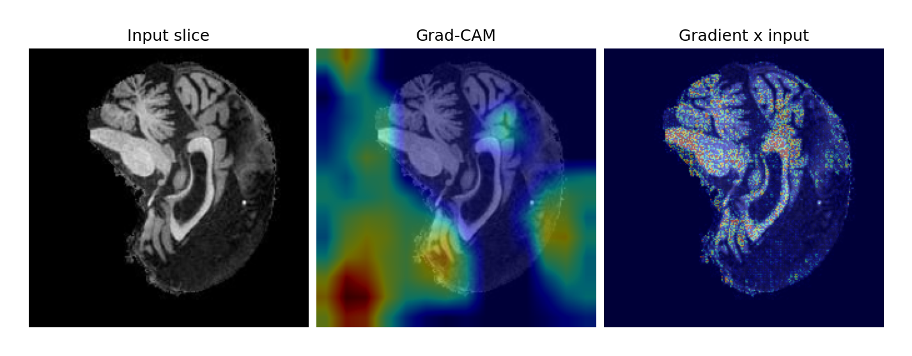\
**Truth:** NC\
**Prediction:** AD\
**P(AD):** 0.985

The cortex looks thin on the right although this half of the slice is much darker, which is unusual. The gradient x input is on the cerebellum and brainstem. Grad-CAM has a large spot on the bottom left on the image onto the background. This is also unusual and indicates the model has found a shortcut by using the background instead of the brain. This will be further investigated in the Overall Autopsy Takeaway and Recommendations.

#### Medium Confidence False Positive
**IMAGE ID**: 1291468_98\
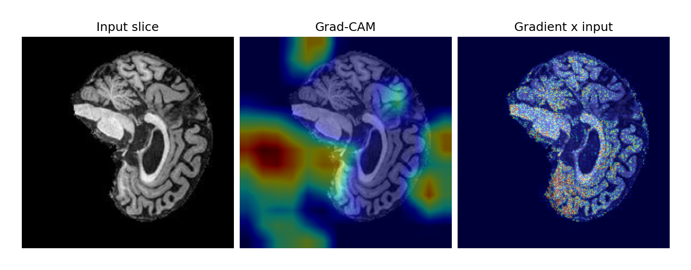\
**Truth:** NC\
**Prediction:** AD\
**P(AD):** 0.702

Similar to the previous false positive, the Grad-CAM shows that the model is looking into the black background, with a particular focus on a spot on the left. Gradient x input is spread over the cerebellum, brainstem and lower cortex. There is no focus on the ventricle or sulci. This once again points to the model using a shortcut instead of analysing the brain scan.

#### High Confidence False Negative
**IMAGE ID**: 1061844_108\
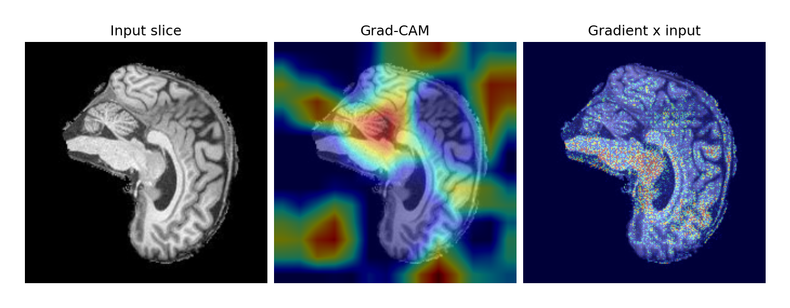\
**Truth:** AD\
**Prediction:** NC\
**P(AD):** 0.006

Unlike the previous false positives, Grad-CAM now shows that the model is looking into the brain such as the cerebellum. It also looks like there are some regions of the background which the model is again looking at. Gradient x input also shows the model is very focused on the brainstem, but not the ventricles or sulci.

#### Medium Confidence False Negative
**IMAGE ID**: 344365_94\
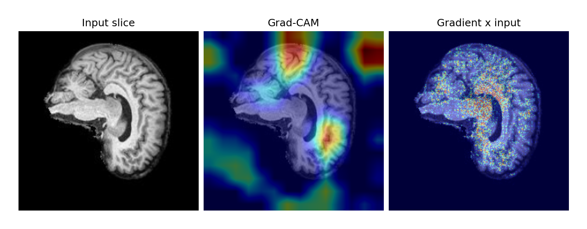\
**Truth:** AD\
**Prediction:** NC\
**P(AD):** 0.303

Grad-CAM shows the model is looking into the brain, however there is a large spot on the top right background. This focus onto the background once again indicates a shortcut. Gradient x input is spread over the white matter around the lateral ventricle. There is some evidence of AD, however, because of the likely shortcut the model tried to take, it predicted NC. This shortcut will be investigated.

### Overall Autopsy Takeaway and Recommendations
There is a systematic failure within the test set. For every scan, the level within the brain it can start differs. All 5 AD scans with their 20 slice window starting at slice 90 or later are false negatives. Meanwhile, 44 of the 45 late-window NC scans are correct. Only 5 of the 121 test AD scans start at slice 90 or later, compared to 45 of the 109 test NC scans. It is possible that the model has learnt to recognise late slices and associate that with NC. The reason why the model would do this is since late scans are overwhelmingly NC. This would explain why it got all the late AD scans wrong.

In all four heatmaps, Grad-CAM shows that the model is looking into the black background or edges of the brain. This means the model is using the size of the brain rather than just the brain tissue. Although center cropping is done, masking should also be implemented to remove this background even more.

Scan averaging can fix slice errors. Although the High Confidence False Positive and Medium Confidence False Negative were wrong at slice levels, they were correctly predicted at the scan level. This strengthens the case to look at a scan level instead of a slice level.

### Recommendations and Trade-Offs
**Background Masking:**
As discussed in the autopsy takeaway and recommendation, it is likely that the background allows inference of slice position. This allows the model to form a shortcut depending on how confident it is of the slice position. Later slices are more likely to be NC, whilst earlier slices, AD. As a result, by adding background masking and then scaling the image, the model will no longer be able to look at the background. Instead, its prediction must come from the brain tissue.

**Accuracy vs Cost:**
Although the GFNet has an accuracy 2.5 percentage points higher (from 77.5% to 80.00%), this comes at the cost of ~19x more parameters and ~1.8x the inference time. Despite this, the GFNet still remains the better option. This is because with an inference time 1.57ms per slice, it could process 1911 scans a minute which is more than enough. Additionally, the increase in specificity from 78.3% to 82.7% is significant since it directly means there are less false positives and a reduction in time and resources spent on unnecessary testing. The increase in recall from 76.9% to 77.6% also means that there is a reduction in false negatives, meaning less patients with AD are missed.

**Decision Threshold:**
The decision threshold is currently set as P(AD) > 0.5. This is a tradeoff since by decreasing it, although there will be less false negatives, there will be more false positives. False positives, however, are far less impactful than false negatives since they just lead to extra testing (as compared to a missed diagnosis). Thus, the decision threshold should be lowered. The high AUROC supports this trade-off, so the threshold should be reduced based on the resources available to handle false positives.

**Patient Level Prediction:**
The model classifies per slice and per scan, however diagnosis happen at the per patient level. P(AD) should be averaged across each patient's scans. This would produce more stable and reliable predictions.

**Incorporating PET Scans:**
The study by [Xu et.al. in 2025](https://dl.acm.org/doi/full/10.1145/3715931.3715943) improved accuracy with NC vs AD from 92.53% with just MRI scans, to 98.91% with a modified GFNet that uses PET scans and MRI scans. By modifying my model to also use PET scan data, the accuracy, recall and specificity can all likely be improved. 

### Answering The Open Research Question 
The model quantifies uncertainty with a P(AD) and P(NC) score that is calculated using softmax. Looking at the GFNet's predictions for slices, the accuracy of that score can be seen:

| Predicted | Confidence | Correct | Wrong | Total | Accuracy |
|---|---|---|---|---|---|
| NC | High (>0.9) | 1,139 | 172 | 1,311 | 86.9% |
| NC | Medium (0.7–0.9) | 468 | 198 | 666 | 70.3% |
| NC | Low (0.5–0.7) | 196 | 172 | 368 | 53.3% |
| **NC total** | | **1,803** | **542** | **2,345** | **76.9%** |

| Predicted | Confidence | Correct | Wrong | Total | Accuracy |
|---|---|---|---|---|---|
| AD | High (>0.9) | 1,190 | 72 | 1,262 | 94.3% |
| AD | Medium (0.7–0.9) | 451 | 151 | 602 | 74.9% |
| AD | Low (0.5–0.7) | 237 | 154 | 391 | 60.6% |
| **AD total** | | **1,878** | **377** | **2,255** | **83.3%** |

| Overall Test Accuracy |
|---|
| 80.00% |

This table categorises every prediction made in the test set as either high confidence (P > 0.900), medium confidence (0.700 <= P <= 0.900), or low confidence (0.500 < P < 0.700) (Note that no predictions had a P of exactly 0.500). For AD, P(AD) is used. For NC, P(NC) is used.

The table shows that when the model predicts AD, it is correct 94.3% of the time when it has high confidence, but only 60.6% of the time with low confidence. When it predicts NC, it is correct 86.9% of the time when it has high confidence, but only 53.3% of the time when it has low confidence. 

It is evident that low confidence NC, low confidence AD and medium confidence NC predictions should be directed for human review. The is because by routing low confidence and medium confidence NC predictions to clinicians, only high confidence NC predictions will be made by the model. This will significantly reduce the number of misses. Low confidence AD should also be routed since the accuracy is only 60.6%. Therefore, by getting a clinican to assess them, the number of false positives can be significantly reduced. Doing this would mean 1425 of the 4600 slices would be routed (30.98%), which still means the model can classify more than two thirds of slices.

Furthermore, as seen in [Reasoning Behind the Model](#reasoning-behind-the-model) and [Benchmarking Against CNN](#benchmarking-against-cnn), the model performs better on scan level predictions compared to slice level. At a slice level, it has an accuracy of 80.00%, but at a scan level, it is 86.50%. Since there are less false positives and negatives, there would be even less scans that must be directed to clinicians since the accuracy at each confidence level will be greater.

Using this advanced model over the baseline CNN is worth the extra computation as the computational difference is minor, as justified in [Computational Efficiency](#computational-efficiency), but the benefits are substantial, as justified in [Benchmarking Against CNN](#benchmarking-against-cnn)

## Reference List
Kiran vutukuri. (2025, October 15). 19.Model evaluation basics: Train, validation, and test splits. Medium. https://medium.com/@kiranvutukuri/19-model-evaluation-basics-train-validation-and-test-splits-ed5bb26b088d

Y. Rao, W. Zhao, Z. Zhu, J. Lu, and J. Zhou, “Global filter networks for image classification,”
IEEE Trans. Pattern Anal. Mach. Intell., vol. 45, no. 6, pp. 7837–7850, 2023.

## Artificial Intelligence Usage Disclosure 
**gfnet_pipeline.png**\
Claude Opus 5.5 was used to generate gfnet_pipeline.png\
I did this by giving it modules.py for my GFNet and asking it to generate a flow diagram that accurately outlines the model architecture.\
I verified that the output image was correct by checking the diagram against the model structure I have made.

**heatmap.py**\
Claude Opus 5.5 was used to generate heatmap.py\
I did this by giving into my GFNet structure and asking it to generate a script that can take an image and model file, and output a two heatmaps (Grad-CAM and a gradient x input).\
I have verified this heatmap is correct by going over the code, and then also checking heatmaps to see if there are any obvious issues. I also modified the code to remove it from printing P(AD) and labels on the image since they will be written underneath in the report.

**data-analysis.py**\
Claude Opus 5.5 was used to create data-analysis.py\
I did this by informing it of the file structure I have set up, and what metrics I want checked by the script.\
I verified this is correct by checking some of the outputs manually, such as file count, patient count and scan count.\
I have also gone through the code to look for errors or bugs

**Table of Contents**\
Claude Opus 5.5 was used to generate the table of contents at the start of the README.md file\
This was done by giving it a list of the section headings, and instructions on how to make it.\
I verified the completed table of contents was correct by checking it against what sections I gave it, and checking each link that it worked.