# GFNet for Identifying Alzheimer's Disease in Brain MRIs
## Table of Contents
 
## The Algorithm
Alzheimer’s disease (AD) is a neurodegenerative condition characterised by difficulties with memory, fatigue, confusion and physical decline. When clinicians suspect AD, it is important that any brain MRIs produced are correctly interpreted. False positives lead to unnecessary testing and use of hospital resources, while false negatives lead to delayed treatment and care, and potentially a misdiagnosis.

The goal of this algorithm is to assist clinicians by being able to analyse brain scans and identify if someone has AD or is cognitively normal (NC). It will achieve this by being able to analyse a brain MRI and determine whether the scan indicates AD or NC, and a probability of it being AD (P(AD)). The algorithm is a GFNet and works in four stages. The first step is patch embedding. The 224x224 image is split into a 14x14 grid of non-overlapping patches. Each patch is projected onto a 256-dimensional vector to produce a 14x14 grid of tokens. The next step is global filtering. The 12 GFNet blocks normalise the token and apply a 2D fast Fourier transform (FFT) on the 14x14 grid. The result is multiplied by a learnable filter and then transformed back with the inverse FFT. The third step is channel mixing. Within each block, a two-layer MLP is applied to each token to mix information across feature channels. Finally, classification occurs. After the 12 blocks, the tokens are normalised and averaged into a single 256-dimensional vector. This is mapped to two logits, and SoftMax is used to create a probability.

The algorithm is based on Y. Rao, W. Zhao, Z. Zhu, J. Lu, and J. Zhou, “Global filter networks for image classification,” IEEE Trans. Pattern Anal. Mach. Intell., vol. 45, no. 6, pp. 7837–7850, 2023. It copies its structure by using a learned positional embedding, a global filter layer, same block structure and final layer. It then slightly modifies it by adding a 4 layer convolutional stem at the beginning.

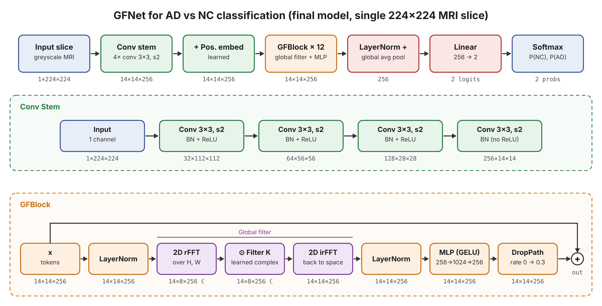

The model works in four primary stages. First, it takes an input image, crops it to 200x200, resizes it to 224x224 and passes it through a convolutional stem. This consists of four 3x3 convolutions that produce an output of 224 channels which each are 14x14. The next step is global filtering. Each of the 12 GFNet blocks applies a LayerNorm, applies a fast fourier transform, multiplies by a learned complex weight and applies an inverse fast fourier transform. The next step is channel mixing. Inside the same block, another LayerNrom and two layer MLP mix information across channels for each token. The whole block is wrapped in a residual connection as well. Finally, classification happens. This is done after all 12 blocks and their output is normalised into one 256-dimensional vector. A linear layer maps it to either AD or NC and softmax is used to give P(AD) and P(NC).

## Reasoning Behind the Model
For the following section, trials refer to the trials in recognition\GFNet_48907736\GFNet\model_tuning

**Cropping:**
Cropping to 200x200, before rescaling it to 224x224 was done because it was found to improve validation accuracy. The dimension of 200x200 was chosen since it safely did that without cropping the brain for any slice. Between trial 7 and 8, one of the key changes made was added this cropping before rescaling. This, alongside increasing the Affine Transformation strength, improved validation accuracy from 0.813 to 0.863. It is likely that cropping improved model performance since it significantly reduced the proportion of the image that was empty space, giving the model more focus on the brain.

**Convolutional Stem:**
The model passes a slice through four 3x3 convolutions with stride 2 (number of channels 1 -> 32 -> 64 -> 128 -> 256), before into the GFNet's blocks. Each convolution is followed by a BatchNorm and ReLU (except for the last). This creates 256 channels of 14x14 slices. This replaces the paper's  Patch Embedding. The reason this was done is seen in trial 1 and 5. The only difference between these runs was that trial 5 used this a convolutional stem whereas trial 1 used a patch embedding. Trial 5 has a validation accuracy 0.844 compared to 0.783 from Trial 1, giving evidence this led to better results. Size of the convolutional stem was also tested in trials 6 and 7, where the difference between them was 6 had structure [in_chans, 32, 64, 128, embed_dim], while 7 had structure [in_chans, 16, 32, 64 embed_dim]. Trial 6 performed better with a validation accuracy of 0.843, compared to 0.813 from trial 7, so that was used. 

**Affine Transformation:**
Trials 1 and 2 compared the effect of random Affine Transformations. Trial 1, which used it, produced a validation accuracy of 0.783. Trial 2, which only differed in not using it, produced a validation accuracy of 0.724. This was evidence that by training the model with random affine transformations applied, there was a better generalisation. The strength of the affine transformation was also tested. Between trial 7  and 8, one of the changes was increasing the transformation from 10 degrees to 15 degrees, as well as adding cropping. These changes improved validation accuracy from 0.813 to 0.863.

**Random Horizontal Flips:**
Random horizontal flips were tested in trials 1 and 3. Trial 1, which used it, produced a validation accuracy of 0.783. Trial 3, which only differed in not using it, produced a validation accuracy of 0.791. Although this intially indicated that random horizontal flips reduced test accuracy, further testing on a later model showed the opposite. Trial 8 and 9 had the same model, except 9 did not use horizontal flips. Trial 8 had the higher validation test accuracy of 0.863, while 9 had 0.853. It is likely that this transformation had minimal impact overall, but was still kept since it improved validation accuracy on the latest model.

**Drop Rate:**
Drop rate was tested at either 0.1 or 0.3. Trial 1 and 4 showed the difference between them on the base models. Trial 1, which used a drop rate of 0.1, had a validation accuracy of 0.783, while trial 4, which had a drop rate of 0.3, had a validation accuracy of 0.793. Drop rate was also tested when there was a convolutional stem in trials 5 and 6, which had drop rates of 0.1 and 0.3, respectively. Both trials produced almost the same validation accuracy, with trial 6 at 0.843 compared to 0.844 from trial 5. Although trials 5 and 6 showed no meaningful difference, trials 1 and 4 showed that increasing drop rate to 0.3 can help, so that was chosen.

**Scan Level Predictions:**
In a clinical setting, a diagnosis is not made over a single slice. It is almost always made over the entire scan. This model does the same by also calculating scan-level statistics. To do this, for each scan, the P(AD) is averaged across every slice. The final average is then used to determine the prediction. This process has resulted in an increase in accuracy. On trial 8, the validation accuracy per slice was 0.863, but per scan was 0.916.

**Final Model:**
The final model uses a Convolutional Stem of [in_chans, 32, 64, 128, embed_dim], Affine Transfomation upto 15 degrees, random horizontal flips, cropping to 200x200 pixels, before rescaling and a drop rate at 0.3.

**Overall Testing Summary**
| Trial | Change                                         | Accuracy  | AUROC     | Specificity | Recall (AD) |
|-------|------------------------------------------------|-----------|-----------|-------------|-------------|
| 1     | Baseline: patch embed + affine + flip          | 0.783     | 0.865     | 0.792       | 0.775       |
| 2     | No affine                                      | 0.724     | 0.806     | 0.581       | 0.862       |
| 3     | No flip                                        | 0.791     | 0.861     | 0.779       | 0.803       |
| 4     | Drop rate increase from 0.1 to 0.3             | 0.793     | 0.864     | 0.818       | 0.769       |
| 5     | Conv stem [32, 64, 128], drop rate 0.1         | 0.844     | 0.923     | 0.793       | **0.894**   |
| 6     | Conv stem, drop rate 0.3                       | 0.843     | 0.923     | 0.838       | 0.848       |
| 7     | Smaller conv stem [16, 32, 64]                 | 0.813     | 0.913     | **0.890**   | 0.739       |
| 8     | Conv stem + increased affine + CenterCrop(200) | **0.863** | **0.932** | 0.870       | 0.856       |
| 9     | Trial 8 without flip                           | 0.853     | 0.915     | 0.861       | 0.845       |

Based off the above metrics, trial 8 produces the best model

## Feasibility Review
### User Need, Scope & Acceptance Criteria
The intended users are clinicians who can use this tool for automated screening to improve productivity and reduce diagnostic errors or misses. The scope will be limited to Alzheimer’s Disease and a positive/negative classification with confidence, using just MRI scans.  

-	Ambiguous cases: Confidence scores (A probability of AD) should be reliably produced for all MRIs. This confidence score should correlate with diagnostic correctness.

-	Handling: For all high confidence negatives, a negative case should be reported. For medium or high confidence positives, a positive case should be reported, and further testing commence. For any medium confidence negatives, or any low confidence result, there should be a human review process.

-	False negatives: Maximising recall is the primary focus. This is because a false negative leads to undetected AD, whilst a false positive leads to an unneeded test. The model will have be considered successful if it can achieve a recall greater than 80%.

-	Overall positives: Although maximising recall is the primary focus, false positives lead to unnecessary health scares and follow up tests, causing strain on the healthcare system. Thus, it is important the specificity is greater than 80%.

-	Computational limits: To process a significant number of images and automate this, it is important the inference time is minimised. The model is considered successful if it can achieve a median inference time of 10ms or less, per image, on a standard A100 GPU. 

### Model Choice & Course Concepts
The data will be split by patients. This is important to prevent data leakage and inflated accuracy scores. It will then be split into approximately 70% training , 15% testing and 15% validation. These percentages were chosen since ADNI is a large dataset (>10 000 entries) and this is a recommended split, and CV is not feasible due to training times.
GFNet will be chosen for the model, with a CNN as the baseline. GFNets  have been used before for AD classification, most notably by Xu et.al. in 2025. With MRI AD vs NC, they achieved an accuracy of 92.53% and were able to improve this to 98.91% by using a modified GFNet that also incorporated PET scans. This study serves as proof that GFNets, even with just MRI data, can detect AD at a reasonable accuracy rate. 
A typical CNN will be chosen for the baseline. This is since this task is fundamentally computer vision, where a model is looking for signs of AD such as progressive hippocampal and cortical atrophy with ventricular enlargement.

### Preliminary Feasibility Evidence
This is feasible and has been done before as stated in the previous section. The data itself is not split by patient yet, and this will have to be done to prevent data leakage. With an A100 and using the ADNI dataset, a GFNet is estimated to take less than 3hrs to train, while a CNN would be at most 30m (estimates from previous runs I have done). I have access to an A100 so there are no issues with resources.

### Risks, Budget & Fallback
I have 80 computing credits with Google Collab, and also free access to UQ’s Rangpur Cluster. This will give me access to A100s and other GPUs to train on. The primary risk of either model is data leakage due to patients not being kept together on datasets, leading to overconfidence and inflated accuracy scores. If GFNets do not work, I can try a ConvNeXt instead.

## Dependencies and Reproducibility
### Dependencies
| Package      | Version |
|--------------|---------|
| Python       | 3.13.16 |
| torch        | 2.11.0 (CUDA 13.0) |
| torchvision  | 0.26.0  |
| scikit-learn | 1.6.1   |
| matplotlib   | 3.10.0  |
| Pillow       | 11.3.0  |
| pandas       | 2.2.3   |

### Reproducibility
The hardware used to run the models was a NVIDIA A100-SXM4-40GB. The hardware is important when it comes to reproducing model training and inference times.\
The test train val split is reproducible since it was done with randomstate=42. Training was also seeded, meaning that the models tested and evaluated can be exactly reproduced.\
As a whole, if the scripts were run again on any GPU, the results achieved are highly reproducible (aside for inference time unless it were run on a similar GPU).

## Example Inputs and Outputs and Plots
### True Positive Case:
The input was a AD brain MRI\
**IMAGE ID:** 258598_90\
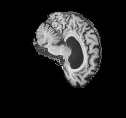\
**Prediction made:** AD\
**P(AD):** 0.967\
There were 1861 images that were true positives (40.46%)

### True Negative Case:
The input was a NC brain MRI\
**IMAGE ID:** 1009810_100\
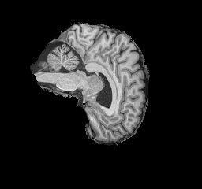\
**Prediction made:** NC\
**P(AD):** 0.001\
There were 1706 images that were true negatives (37.09%)

### False Positive Case:
The input was a NC brain MRI\
**IMAGE ID:** 1075136_84\
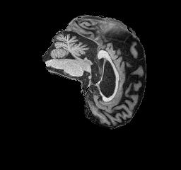\
**Prediction made:** AD\
**P(AD):** 0.95\
There were 474 images that were false positives (10.30%)

### False Negative Case:
The input was a AD brain MRI\
**IMAGE ID:** 300034_76\
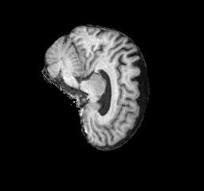\
**Prediction made:** NC\
**P(AD):** 0.288\
There were 559 images that were false negatives (12.15%)

### Confusion Matrix 
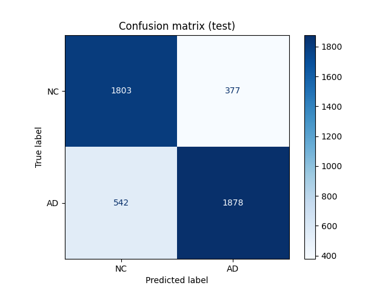\
As stated above, there were 1861 images that were true positives (40.46%), 1706 images that were true negatives (37.09%), 474 images that were false positives (10.30%) and 559 images that were false negatives (12.15%).

### Accuracy Curve
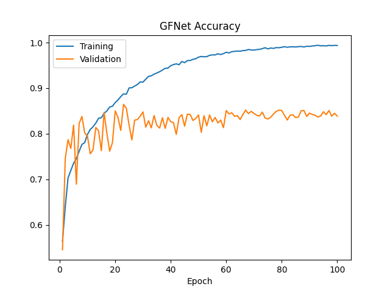\
By the end of training, the model reached a validation accuracy of 83.9%, and a training accuracy of 98.9%.

### ROC Curve
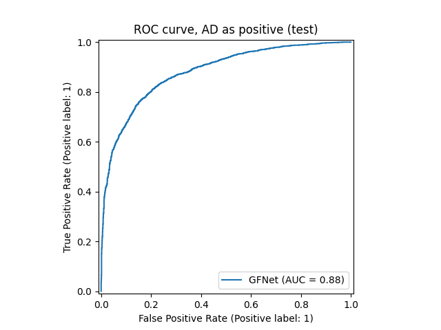\
By the end of training, the model reached a AUROC of accuracy of 0.881

## Preprocessing and Data Split
### Dataset

### Pre-Processing

### Data Split
The data was split as 70% training, 15% validation and 15% testing. Splits were done by patient since brainscans from the same patient are typically similar. This meant if a patient's brainscan was in the testing and training set, then the final test accuracy will be skewed. The split 70 / 15 / 15 was chosen under advice from a tutor and by this [article](https://medium.com/@kiranvutukuri/19-model-evaluation-basics-train-validation-and-test-splits-ed5bb26b088d), which stated for large dataset (>10000 items), it is better to have a larger test and validation set since the training set has enough items already. 

## Investigation
### Benchmarking Against CNN
Both models were evaluated on the same test set of 4600 images. Both models were also trained on the same set of images.

| Metric                 | CNN baseline | GFNet     |
|------------------------|--------------|-----------|
| Slice accuracy         | 0.775        | **0.800** |
| Slice macro-F1         | 0.775        | **0.800** |
| Recall (AD)            | 0.769        | **0.776** |
| Specificity            | 0.783        | **0.827** |
| Slice AUROC            | 0.854        | **0.881** |
| Scan accuracy          | 0.839        | **0.865** |
| Scan macro-F1          | 0.839        | **0.865** |
| Scan AUROC             | 0.903        | **0.932** | 

The GFNet outperforms the CNN on every metric. It improves slice accuracy by 2.25 percentage points, from 77.5% to 80.00% and slice AUROC by 0.027 from 0.854 to 0.881. Recall improves from 76.69% to 77.6% and specificity improves from 78.3% to 82.27%. At a scan level, these improvements are seen again. Scan accuracy is improved by 2.60 percentage points from 83.9% to 86.5%, and scan AUROC improves by 0.029 from 0.903 to 0.932.

Overall, it is evident the GFNet is superior in classifying AD vs NC brain MRIs. This difference in performance is very valuable since the increased specificity and recall mean less missed diagnosis from false negatives, and less wastage of hospital resources from false positives.

### Computational Efficiency
Models were trained and evaluated on a Nvidia A100 40GB GPU.

| Metric                      | CNN baseline              | GFNet                     |
|-----------------------------|---------------------------|---------------------------|
| Parameter count             | **389,314**               | 7,446,754                 |
| Peak GPU VRAM (batch of 64) | 847.6 MB                  | **362.6 MB**              |
| Median inference time       | **0.84 ms** per image     | 1.57 ms per image         |
| Input size                  | 1 × 224 × 224 (greyscale) | 1 × 224 × 224 (greyscale) |

The GFNet has 7,446,754 parameters compared to only 389,314 on the baseline CNN. On a Nvidia A100 GPU, the GFNet takes 1.57ms per slice, meaning its max throughput would be around 654 images per second. This is more than fast enough, as at 20 slices per scan, this is around 1961 scans a minute. Although the CNN is significantly faster at 0.84ms per image, this extra speed is not necessary. The peak VRAM usage during inference is 362.6MB for the GFNet and 847.6MB for the CNN (with a batch of 64). Although this means that both models can run on consumer grade GPUs easily and not hit memory limits, the GFNet is significantly more efficient. To summarise, both models are computationally efficient, with the CNN holding the advantage with less parameters, while the GFNet's advantage lies in requiring less VRAM during inference.

### GFNet Error Autopsies 
#### High Confidence False Positive
**IMAGE ID**: 920975_100\
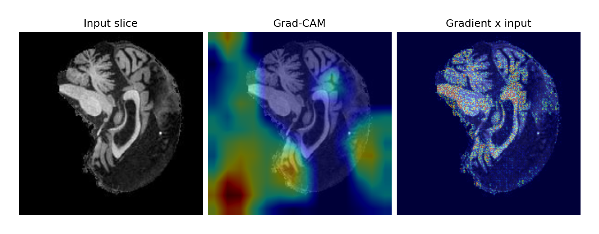\
**Truth:** NC\
**Prediction:** AD\
**P(AD):** 0.985

#### Medium Confidence False Positive
**IMAGE ID**: 1291468_98\
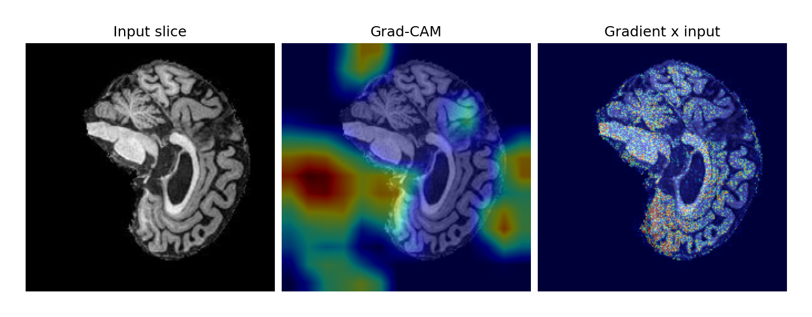\
**Truth:** NC\
**Prediction:** AD\
**P(AD):** 0.702

#### High Confidence False Negative
**IMAGE ID**: 1061844_108\
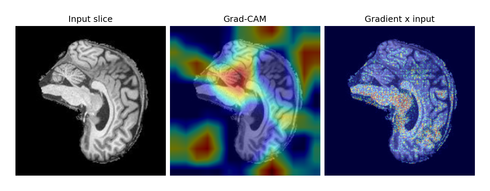\
**Truth:** AD\
**Prediction:** NC\
**P(AD):** 0.006

#### Medium Confidence False Negative
**IMAGE ID**: 344365_94\
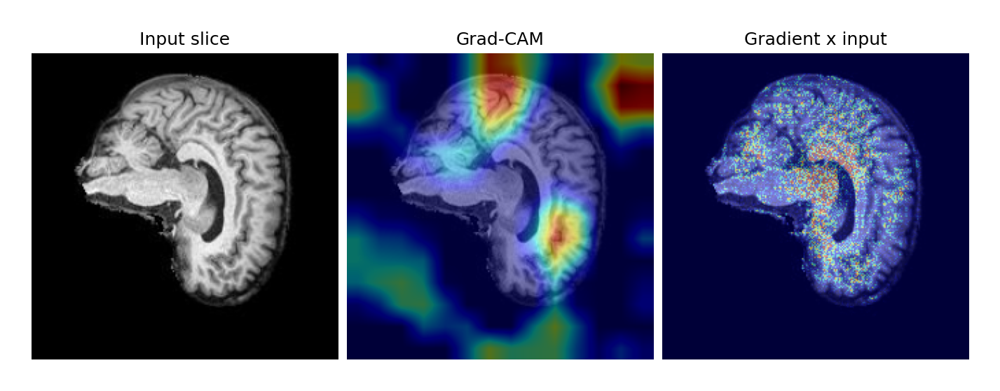\
**Truth:** AD\
**Prediction:** NC\
**P(AD):** 0.303

### Overall Autopsy Takeaway and Recommendations

### Recommendations and Trade-Offs
**Accuracy vs Cost:** Although the GFNet has an accuracy 2.25 percentage points higher (from 77.5% to 80.00%), this comes at the cost of ~19x more parameters and ~1.8x the inference time. Despite this, the GFNet still remains the better option. This is because with an inference time 1.57ms per slice, it could process 1961 scans a minute which is more than enough. Additionally, the increase in specificity from 78.3% to 82.27% is significant since it directly means there are less false positives and a reduction in time and resources spent on unnecessary testing. The increase in recall from 76.69% to 77.6% also means that there is a reduction in false negatives, meaning less patients with AD are missed.

**Decision Threshold:** The decision threshold is currently set as P(AD) > 0.5. This is a tradeoff since by decreasing it, although there will be less false negatives, there will be more false positives. False positives, however, are far less impactful than false negatives since they just lead to extra testing (as compared to a missed diagnosis). Thus, the decision threshold should be lowered. The high AUROC supports this trade-off, so the threshold should be reduced based on the resources available to handle false positives.

**Patient Level Prediction:** The model classifies per slice and per scan, however diagnosis happen at the per patient level. P(AD) should be averaged across each patient's scans. This would produce more stable and reliable predictions.

**Incorporating PET Scans:** The study by [Xu et.al. in 2025](https://dl.acm.org/doi/full/10.1145/3715931.3715943) improved accuracy with NC vs AD from 92.53% with just MRI scans, to 98.91% with a modified GFNet that uses PET scans and MRI scans. By modifying my model to also use PET scan data, the accuracy, recall and specificity can all likely be improved. 

## AI Disclosure 
**gfnet_pipeline.png**\
Claude Opus 5.5 was used to generate gfnet_pipeline.png\
I did this by giving it modules.py for my GFNet and asking it to generate a flow diagram that accurately outlines the model architecture.\
I verified that the output image was correct by checking the diagram against the model structure I have made.

**heatmap.py**\
Claude Opus 5.5 was used to generate heatmap.py\
I did this by giving into my GFNet structure and asking it to generate a script that can take an image and model file, and output a two heatmaps (Grad-CAM and a gradient x input).\
I have verified this heatmap is correct by going over the code, and then also checking heatmaps to see if there are any obvious issues. I also modified the code to remove it from printing P(AD) and labels on the image since they will be written underneath in the report.

**data-analysis.py**
Claude Opus 5.5 was used to create data-analysis.py\
I did this by informing it of the file structure I have set up, and what metrics I want checked by the script.\
I verified this is correct by checking some of the outputs manually, such as file count, patient count and scan count.\
I have also gone through the code to look for errors or bugs

**Table of Contents**\
Claude Opus 5.5 was used to generate the table of contents at the start of the README.md file\
This was done by giving it a list of the section headings, and instructions on how to make it.\
I verified the completed table of contents was correct by checking it against what sections I gave it, and checking each link that it worked.